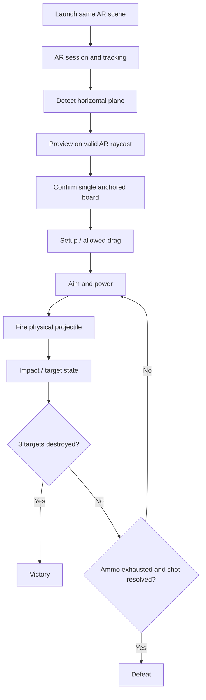

# Tiny Siege AR — Architecture (MVP v1)

**Status:** Design baseline for implementation; subject to validation against Unity Editor and device tests. **Project:** Unity 6000.3.17f1, URP 17.3.0, AR Foundation 6.3.5, ARCore XR Plugin 6.3.5, XR Plug-in Management 4.5.4, Input System 1.19.0, IL2CPP ARM64, minimum Android API 25 (verify effective project settings before build).

## 1. Product and academic acceptance
A player scans a horizontal real surface, places a miniature medieval battlefield, aims a catapult, chooses power and fires physics-driven stone projectiles. Destroy **three targets** with limited ammo to win. No AI, multiplayer, procedural destruction, persistent saves or advanced pooling for this MVP.

**Exclusion criteria from assignment:** application must **run both on Android and in XR Simulation and detect planes functionally**. Required submission: PDF GDD, Android APK and a video showing GDD, Unity hierarchy/raycasts/culling masks and a functional demo. Graded work includes rigidbodies/colliders, functional drag and drop with kinematic transitions, UI click-through protection, light estimation and actual shadow-catching integration.

## 2. Architecture decisions
- **One scene:** `Assets/_Project/Scenes/AR_Main.unity` plus temporary isolated tests only if useful. Unity's native XR bootstrap selects the platform loader; do not add a custom GameBootstrapper without a demonstrated need.
- **Native AR managers** are preferred over redundant wrappers: `ARSession`, `XR Origin (AR)` with AR camera, `ARPlaneManager`, `ARRaycastManager`, and `ARAnchorManager` as needed. Placement stays in one concrete `PlacementController` initially.
- **One scene root anchored to detected surface** (rather than an anchor per destructible block). Validate the AR Foundation 6.3 anchor creation API actually available. Avoid creating anchors every frame.
- **Separated concerns:** AR placement knows AR Foundation, gameplay controllers do not; projectile and destructible components rely on Unity physics; UI calls controlled methods and observes state events.
- **Local references and C# events** before DI, generic service interfaces, event buses, ECS or DOTS.
- **Virtual collision board:** cheap collider independent of AR plane visualization and of the shadow-catching mesh. Never assume an AR plane automatically supplies a physics collider for falling blocks.
- **Real shadows:** render an invisible receiver that composites virtual shadows onto the camera feed, compatible with the configured URP renderer. A generic Unlit/Transparent material alone is not a real shadow catcher. Test on Android; soft fake shadows are only fallback visuals.
- **Graphics API:** confirm effective Android API choices and package-specific validation in Unity. OpenGLES3 is a conservative MVP choice; do not characterize Vulkan as universally unsupported by ARCore 6.3 without checking target API/version and requirements.

## 3. Scene and dependencies
```text
AR_Main
├── AR Session
├── XR Origin (AR)
│   └── Camera Offset / AR Camera (AR Camera Manager + Background)
│   ├── AR Plane Manager
│   ├── AR Raycast Manager
│   └── AR Anchor Manager (if used by placement)
├── PlacementController (references managers, prefab, UI guard)
├── Directional Light + Light Estimation component (later)
└── Canvas + EventSystem (later)

PlacedBoardPrefab (instantiated once)
├── BoardRoot + physics collision surface
├── Fortress / 3 destructible objectives
├── Catapult
└── ShadowReceiver (separate renderer)
```
Actual manager component placement in hierarchy may vary; validate in Inspector rather than relying on this diagram as a serialization recipe.

## 4. Component contracts (add only when feature requires)
| Component | Single responsibility | Dependencies / boundaries |
| --- | --- | --- |
| `PlacementController` | Query horizontal-plane raycasts, show preview, place one anchored prefab | AR managers; rejects UI touches and invalid hits; does not start gameplay rules |
| `MatchController` | Ammunition, match phase, win/lose when three targets destroyed | Events to UI; no direct AR Foundation dependency |
| `CatapultController` | Direction/power and fire request | Validates fire action; delegates projectile creation |
| `ProjectileController` | Initial velocity, physics lifetime, impacts | Rigidbody+Collider, not UI or match state |
| `DestructibleTarget` | One-time damage/destruction event | Prebuilt fragment swaps and bounded rigidbodies; guard against double count |
| `DragController` | Controlled drag of allowed object(s) during setup | Pointer-specific UI blocking, kinematic transition and explicit release policy |
| `LightEstimationController` | Read supported environment estimates, apply light with fallback | AR Camera Manager; safe if data unavailable |
| `ShadowReceiver` | Actual shadow-catching rendering | Separate from board collision; validated URP renderer/shader |

## 5. Runtime flow


## 6. Input and physics constraints
- Handle mouse (XR Simulation) and touch (Android) through the Input System. Treat each pointer distinctly; block world actions originating on UI (`EventSystem`/`GraphicRaycaster`, correct touch pointer ID).
- Limit placement to one board; avoid repeated press/frame duplication. Failed plane hits must not instantiate.
- On drag, save the physical state actually needed, set `isKinematic=true`, move safely and clamp movement within board limits. Restore defined gravity/constraints/kinematic state. Don't blindly reapply stale velocities; default release to zero velocity unless gameplay explicitly requires throwing.
- Projectile uses Rigidbody/SphereCollider, tuned fixed timestep and appropriate collision detection only where needed. Fragmented targets use a few pre-authored physics pieces, primitive colliders and capped lifetime; do not fracture meshes procedurally.
- If tracking degrades, provide feedback and reject sensitive placement while pose is unreliable; avoid duplicating or deleting board unexpectedly.

## 7. Acceptance per platform
**Phase 1 mandatory technical demo:** both XR Simulation and Android real device detect horizontal planes; valid pointer raycast places **exactly one** anchored cube; invalid hit places none; UI input does not leak to placement; placed object remains stable as viewpoint changes. Loader registration or successful editor Play Mode alone is not evidence of Android behavior.

**Final graded checks:** functional drag/kinematic restoration, physical impact on colliders, three target win/lose logic, light estimation with safe fallback, real shadow-catching on real environment, stable APK, video and GDD PDF. Log test device, API level, build version and evidence.

## 8. Risks and mitigations
- XR Simulation may lack configured environment: select/import a valid simulation environment, test plane discovery in Play Mode.
- AR light estimates may be absent or limited by device: use a predictable default light and only use supported fields.
- URP shadow receiver requires suitable shader/blending and culling configuration; a transparent or Unlit plane alone is insufficient.
- Android performance: profile on hardware; avoid overdraw and large counts of active rigidbodies.
- Anchors need XR subsystem support and correct lifecycle. Never assume static file inspection proves runtime operation.

## 9. Decision log
- 2026-10-26: Accepted Codex review simplification: one scene, no initial bootstrapper, focused concrete components, AR first.
- 2026-10-26: Retain **Drag & Drop** and **real Shadow Catcher** as graded deliverables, not optional stretch goals.
- 2026-10-26: Version/configuration fields reflect read-only audit and must be verified in Unity after any package change.
